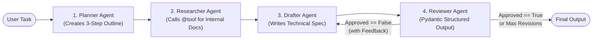

# Understanding LangGraph Multi-Agent Workflows

A progressive, hands-on engineering repository exploring production **Multi-Agent Systems** built with **Python**, **LangGraph**, and **Google Gemini**.

## Architecture Overview



## Milestones in This Repository

| File | Core Multi-Agent Concept |
| :--- | :--- |
| `milestone1_graph.py` | **Shared Typed State (`TypedDict`) & Graph Wiring**: How multiple agent nodes read from and write partial updates to a shared whiteboard (`StateGraph`, `START`, `END`). |
| `milestone2_graph.py` | **Role-Based AI Agents**: Connecting `ChatGoogleGenerativeAI` with role-specific `SystemMessage` and dynamic `HumanMessage` context. |
| `milestone3_graph.py` | **Tool Calling (`@tool` + `bind_tools`)**: Giving a `researcher_agent` access to internal company standards before handing off facts to the Drafter. |
| `milestone4_graph.py` | **Self-Correction Loops & Structured Outputs**: Using `Pydantic` (`with_structured_output`) for deterministic Reviewer decisions, `add_conditional_edges` for routing, and `revision_count` guardrails to prevent infinite loops. |

## Quickstart

1. **Create and activate a virtual environment:**
   ```powershell
   python -m venv .venv
   .\.venv\Scripts\Activate.ps1
   pip install -r requirements.txt
   ```

2. **Configure your API key:**
   Copy `.env.example` to `.env` and add your Google Gemini API key:
   ```powershell
   Copy-Item .env.example .env
   ```

3. **Run any milestone:**
   ```powershell
   python milestone4_graph.py
   ```

